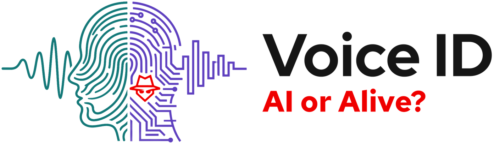

<p align="center">
  
</p>

# Voice ID: AI or Alive?

A conference booth game about trusting voices. Players hear five short clips,
some real people and some AI clones of the same people saying the same sentences,
and decide **natural voice** or **AI generated** as fast as they can. In battle
mode they compete against four AI detectors, from a 7B audio LLM to a fine-tuned
deepfake classifier. Everything runs in one namespace on Red Hat OpenShift; Red Hat
OpenShift AI serves the generative opponents with vLLM on NVIDIA L4 GPUs and the
predictive classifiers with OpenVINO Model Server on CPU. No voice leaves the cluster.

**New here?** Start with the [portal](https://agiertli.github.io/voice-id/)
(source in [`portal/`](portal/)): what the game is, how to play, the opponents,
scoring with worked examples and the architecture.

## Rule zero: no audio in this repository

This repository is public. Voice recordings of real people, clones, speaker
photos, seed packs and databases are sensitive personal data and **never** go into
Git, issues or pull requests. Teams get the clips as a private **seed pack**; see
[docs/SEEDING.md](docs/SEEDING.md). The old `samples/` folders were removed on
purpose. Enable the guard once per clone:

```bash
git config core.hooksPath .githooks
```

Further guards: `.gitignore` audio/database patterns, the `no-audio` CI workflow and,
for Claude Code, a PreToolUse hook (`.claude/hooks/block-voice-data.sh`, registered in
`.claude/settings.json`, needs `jq`) that blocks git/gh commands and file writes
involving voice data. Full rule: top of [AGENTS.md](AGENTS.md). Rule Two there: every
significant change updates the skill, docs, portal and diagrams in the same commit.

## Install

Three install profiles; Voice Clone Studio and its GPUs are optional because the
game only plays pre-recorded clips:

| Profile | GPUs (NVIDIA L4) | Opponents | Voice cloning | Approx. GPU cost* |
|---|---:|---|---|---|
| `minimal` | 0 | Gary, Gary 2.0 | no | none |
| `standard` (recommended for booths) | 2 | all four | no | ≈ $2/h |
| `full` (voice collection) | 4 | all four | Clone Studio, XTTS, Fish | ≈ $4/h |

\* About $1/h per `g6.2xlarge` on demand, approximate; check current AWS pricing.

```bash
export KUBECONFIG=~/.kube/voice-id-<event>.kubeconfig   # log in yourself; the script never runs oc login
./install.sh --profile standard --admin-token-file ~/.voice-id-admin-token --dry-run
./install.sh --profile standard --admin-token-file ~/.voice-id-admin-token
```

`install.sh` deploys the detectors on OpenShift AI's OpenVINO Model Server for every
profile: it needs the OpenVINO IR of the two models in `~/voice-id-audio/ovms/repo/`
(`--ovms-model-dir`, from the owner or `export_openvino.py`; copied onto PVCs) and
pulls the small adapter image from `quay.io/agiertli/voice-id-ovms-adapter`. `--legacy-detectors` is an emergency fallback; `--wait-cache`
warms the opponent answer cache. It is checked with ShellCheck and mocked dry runs but
not yet end-to-end on a fresh cluster. About 35 minutes for `full` on a fresh
OpenShift AI 3 cluster.

- [Installation runbook](docs/INSTALLATION.md): GPU nodes, opponents, TTS engines,
  the game, Voice Clone Studio, verification, troubleshooting.
- [Install with an agent](docs/AGENT-INSTALLATION.md): Claude Code or Codex with the
  `voice-id-operations` skill and a copyable prompt.
- [Seeding](docs/SEEDING.md): load, export and share the clips.

## Operate and customize

- [Customization index](docs/CUSTOMIZATION.md)
- [Scoring](docs/customization/scoring.md): exactly how points, prizes and the
  leaderboard work, with worked examples and known limitations
- [AI opponents](docs/customization/ai-opponents.md),
  [clips and speakers](docs/customization/clips-and-speakers.md),
  [languages](docs/customization/languages.md),
  [booth operations](docs/customization/booth-operations.md),
  [backups](docs/customization/backups.md)
- [Architecture](docs/ARCHITECTURE.md)

## Agents

[AGENTS.md](AGENTS.md) and [CLAUDE.md](CLAUDE.md) hold the same instructions. The
skill lives in [.agents/skills/voice-id-operations](.agents/skills/voice-id-operations/SKILL.md)
(Codex) and is symlinked at `.claude/skills/voice-id-operations` (Claude Code). Keep
the symlink when cloning. Claude Code also has a background agent at
`.claude/agents/voice-id.md`.

## Repository layout

```text
apps/voice-id/             the game (Flask, SQLite), Helm chart, tools/ (seedpack, Clone Studio import)
apps/voice-clone-studio/   voice cloning and sentence recording app, Helm chart
apps/deepfake-detector/    detector research and training, OpenVINO export, OVMS adapter (Gary, Gary 2.0)
infra/                     GPU MachineSet example, LLM opponents, OpenVINO detectors (+ legacy rollback), TTS engines
docs/                      runbooks and guides
portal/                    public GitHub Pages site (Vite + React)
```

## Supportability

A custom conference demo built on Red Hat OpenShift and OpenShift AI with
community models (Qwen2-Audio, Coqui XTTS v2, Fish Speech, Wav2Vec2) and a Red Hat
AI published Gemma model, served by OpenShift AI's vLLM and OpenVINO Model Server runtimes. Single replicas and SQLite: fine for a booth, not a
production design, and not a Red Hat supported solution as a whole.
