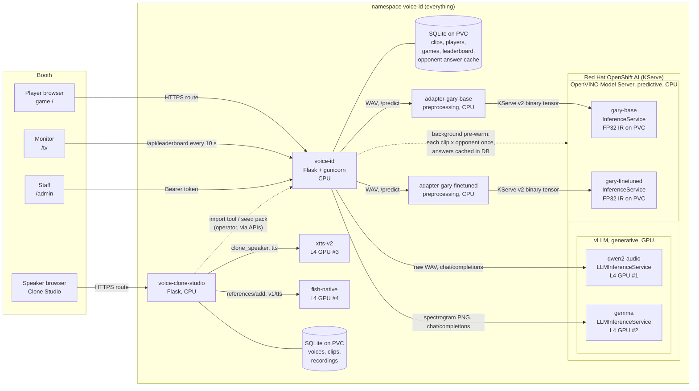
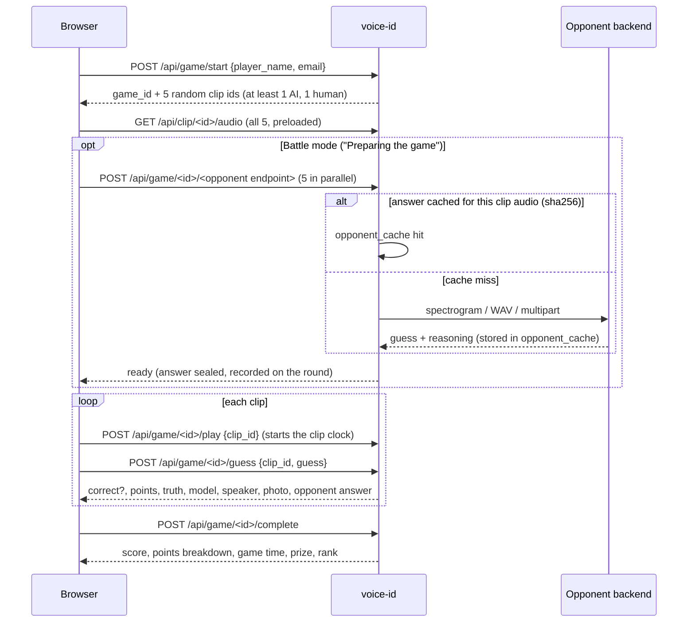
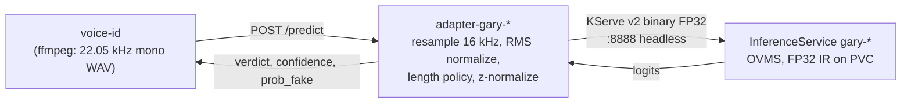
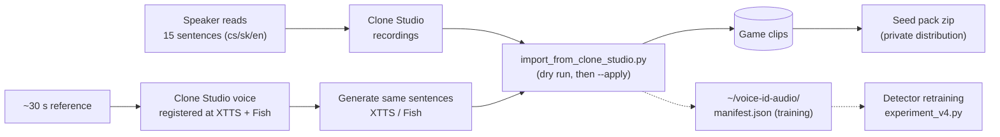

# Architecture

Background for operators and presenters. Deployment specifics live in
[INSTALLATION.md](INSTALLATION.md), the Helm charts and `infra/` manifests; if this
page and those disagree, the manifests win.

## Overview

One namespace holds everything. Red Hat OpenShift AI serves all four opponents through
KServe: the two generative models (Teddy, Iris) with vLLM on GPUs, the two predictive
Wav2Vec2 classifiers (Gary, Gary 2.0) with the built-in OpenVINO Model Server on CPU.

The game never calls the TTS engines. Clips are made beforehand (Clone Studio or
offline scripts) and stored in the game database. XTTS and Fish serve Clone Studio
only.

## Install profiles

| Profile | Workloads | GPU nodes |
|---|---|---:|
| minimal | `voice-id`, OpenVINO detectors `gary-base` + `gary-finetuned` with their adapters (all CPU) | 0 |
| standard | minimal + `qwen2-audio`, `gemma` | 2 |
| full | standard + `xtts-v2`, `fish-native`, `voice-clone-studio` | 4 |

The game's runtime path never touches XTTS or Fish, so `minimal` and `standard` are
complete booths; `full` adds the clip-making side. Opponents not deployed are
disabled with Helm flags and disappear from the API, the game and `/tv`. See
[install profiles](INSTALLATION.md#install-profiles).

## Components

| Component | Image / model | Hardware (requests / limits) | Storage | Exposure |
|---|---|---|---|---|
| `voice-id` | `quay.io/agiertli/voice-id` (UBI9 Python 3.12, gunicorn 4 workers × 4 threads) | 0.5 / 2 CPU, 512 Mi / 1 Gi | PVC `voice-id-data` 1 Gi RWO (SQLite, WAL) | Route, edge TLS, 120 s timeout |
| `qwen2-audio` | vLLM via KServe LLMInferenceService, `Qwen/Qwen2-Audio-7B-Instruct`, max len 4096 | 1 L4, 1 / 4 CPU, 8 / 24 Gi | PVC `qwen2-audio-model` 20 Gi | Internal `https://qwen2-audio-kserve-workload-svc:8000/v1` |
| `gemma` | vLLM via LLMInferenceService, `RedHatAI/gemma-4-12B-it-FP8-dynamic`, served as `gemma-4-12b`, max len 8192, 1 image per prompt | 1 L4, 1 / 4 CPU, 8 / 24 Gi | PVC `gemma-model` 30 Gi | Internal `https://gemma-kserve-workload-svc:8000/v1` |
| `gary-base` | KServe InferenceService, built-in `kserve-ovms` ServingRuntime (Red Hat OVMS 2026.2, `--rest_workers=16`, FP32 pinned), Wav2Vec2-XLSR pre-trained as FP32 OpenVINO IR | 2 / 4 CPU, 4 / 6 Gi (+ kube-rbac-proxy) | PVC `gary-base-models` 5 Gi | Internal, headless `gary-base-predictor:8888` (KServe v2) |
| `gary-finetuned` | Same runtime, V4-A fine-tune as FP32 IR | 2 / 4 CPU, 4 / 4 Gi (+ kube-rbac-proxy) | PVC `gary-finetuned-models` 5 Gi | Internal, headless `gary-finetuned-predictor:8888` |
| `adapter-gary-base`, `adapter-gary-finetuned` | `quay.io/agiertli/voice-id-ovms-adapter:v0.1.1` (UBI9, numpy/scipy, no weights) | 0.1 / 1 CPU, 128 / 512 Mi each | none | Internal Service :8080 (`/predict`, `/health`, `/ready`) |
| `xtts-v2` | `ghcr.io/coqui-ai/xtts-streaming-server` (pinned by digest) | 1 L4, 4 CPU, 8 Gi | none | Service :80, route |
| `fish-native` | `docker.io/fishaudio/fish-speech` (pinned by digest), S2 Pro, `--compile` | 1 L4, 4 CPU, 16 Gi | PVC `fish-data` 20 Gi (weights); references in memory | Service :8080, route (300 s) |
| `voice-clone-studio` | `quay.io/agiertli/voice-clone-studio:v2.2.1` | 0.1 / 0.5 CPU, 128 / 256 Mi | PVC `voice-clone-studio-data` 1 Gi | Route, 300 s timeout |

GPU nodes (`full`; `standard` has the first two): four `g6.2xlarge` (1× NVIDIA L4 24 GB, 8 vCPU, 32 GiB), tainted
`nvidia.com/gpu=true:NoSchedule`, one GPU workload each. Every GPU workload
requests a whole GPU; there is no sharing.

## Game flow

The server is the authority for correct answers, points, game time (first play
press to last answer) and the prize; the browser only displays them. Full rules:
[scoring](customization/scoring.md).

A background thread (one warming process at a time, chosen through a database lease)
pre-computes every opponent's answer for every clip, so the battle pre-analysis is
near-instant once warm. Details: [answer cache](customization/ai-opponents.md#answer-cache-and-background-pre-warm).

## Opponent analysis paths

| Opponent | What the server sends | Model input |
|---|---|---|
| Teddy (`qwen`) | Clip converted to 22.05 kHz mono WAV, base64 `audio_url` + forensic prompt | Audio |
| Iris (`gemma`) | Server renders a spectrogram (matplotlib, 0–8 kHz, magma), base64 `image_url` + prompt | **Image** (only opponent using spectrograms) |
| Gary (`gary-base`) | WAV as multipart to the adapter's `/predict`; the adapter preprocesses and calls OVMS | Waveform (whole clip); verdict from `p_fake` thresholds 0.3 / 0.7 |
| Gary 2.0 (`gary-finetuned`) | Same | Waveform (first 10 s); same thresholds |

Details: [AI opponents](customization/ai-opponents.md).

### How the Garys are served (OpenVINO Model Server)

Since 2026-11-25 (Helm `detectorBackend: openvino`, the default) Gary and Gary 2.0 run on OpenShift AI's built-in
OpenVINO Model Server (`infra/openvino-detector/`):

- The adapters keep the old detector HTTP API (`/predict`, `/health`, `/ready`, same JSON), so the game code did not change.
- Length policy: Gary 2.0 scores a fixed 10 s (160000 samples, padded or truncated); Gary base scores the clip at native length.
- Proof: 0 verdict flips on all 129 live clips per model (max |Δp_fake| 0.0001); 2.2–3.3x faster at the same 4-CPU limit
  (Gary 2.0 single clip 2.7 s → 1.2 s, 5 parallel 17.9 s → 6.1 s); about 2.8x throughput per CPU; about 2x the memory requests.
- The legacy Flask/PyTorch Deployments (`infra/deepfake-detector*/`) are decommissioned and kept only as emergency rollback manifests
  (`./install.sh --legacy-detectors`, Helm `detectorBackend=legacy`).

Payload contract: [OPENVINO-DETECTOR.md](OPENVINO-DETECTOR.md). Evidence and rollback: [OPENVINO-SWITCH-BRIEF.md](OPENVINO-SWITCH-BRIEF.md).

## Clip pipeline

Audio exists only in the two cluster databases and in local folders outside the
repository; nothing in this pipeline touches Git.

## Data model (game)

| Table | Content |
|---|---|
| `clips` | id, filename, is_ai, language, source (TTS name), speaker, audio BLOB, content type, audio_sha256 |
| `players` | nickname (unique), email |
| `games` | id, player, clip ids, guesses JSON, score, total, points, duration, opponent, completed |
| `leaderboard` | one row per completed game: player, score, total, points, duration, opponent |
| `clip_stats` | times played, guessed AI, guessed human (per clip) |
| `speakers` | display name and photo per speaker key |
| `game_rounds` | per game and clip: first play, guess, points, the opponent's recorded answer |
| `opponent_cache` | per opponent and clip: cached answer, detector details, Iris spectrogram, audio sha256 it is valid for |
| `opponent_cache_meta`, `opponent_cache_runs` | pre-warm lease, last run, per-opponent run status |

## Design constraints

- Single replica, SQLite on a RWO volume: no HA. A pod restart interrupts games in
  progress; completed results survive on the PVC.
- No authentication for players; all game admin endpoints (including clip
  management and score reset) use one shared Bearer token; the Clone Studio API is
  unauthenticated. Game scoring is server-side.
- The OVMS predictors and adapters have no auth and no Route (cluster-internal only);
  a NetworkPolicy limiting ingress to the game pod is an optional hardening step.
- LLM endpoints are cluster-internal and called with TLS verification off; external
  exposure needs Red Hat Connectivity Link.
